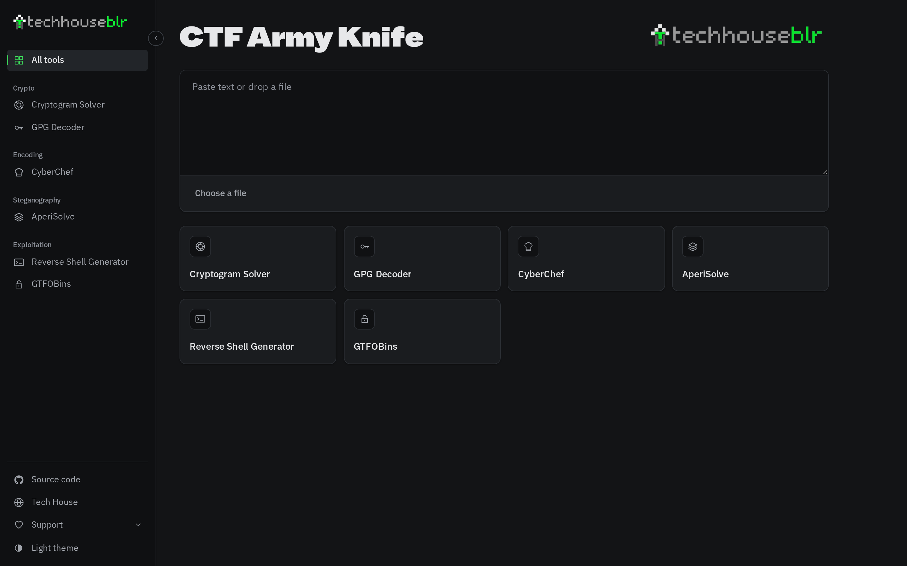
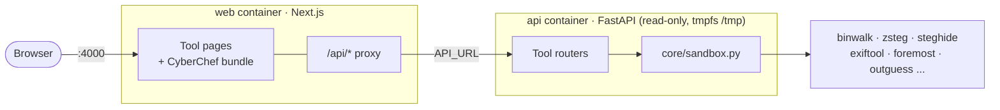

<div align="center">

# CTF Army Knife

**A Swiss army knife for CTFs.**<br>
Crypto, encoding, steganography and exploitation tools in one self-hosted web app. Paste or drop a file to get started.

[](https://github.com/tech-house-blr/ctf-army-knife/actions/workflows/ci.yml)
[](LICENSE)

[**Features**](#features) ·
[**Quick start**](#quick-start) ·
[**Architecture**](#architecture) ·
[**Adding a tool**](#adding-a-tool) ·
[**Tests**](#tests) ·
[**Credits**](#branding-credits-and-licences)

<br>

<picture>
  <source media="(prefers-color-scheme: light)" srcset="docs/assets/screenshots/home-light.png">
  
</picture>

</div>

<br>

## Features

Six tools behind one paste-and-go dashboard. Each has its own page; the home page suggests the right one for whatever you paste or drop.

| Tool | | Runs in |
| ---- | --- | ------- |
| **[Cryptogram Solver](apps/web/app/cryptogram-solver)** | Break substitution ciphers with frequency analysis and simulated annealing. | API |
| **[GPG Decoder](apps/web/app/gpg-decoder)** | Inspect OpenPGP packets with a colour-matched hex view. | Browser |
| **[CyberChef](docs/cyberchef.md)** | The full CyberChef catalogue, themed and served locally. | Browser |
| **[AperiSolve](apps/web/app/aperisolve)** | Image steganography: bit planes, metadata and a suite of extraction tools, streamed live. | API |
| **[Reverse Shell Generator](apps/web/app/reverse-shell)** | Reverse, bind, MSFVenom and HoaxShell payloads with matching listeners. | Browser |
| **[GTFOBins](apps/web/app/gtfobins)** | Searchable GTFOBins index, filtered by function and privilege context. | Browser |

Plus a dark/light theme with a collapsible sidebar, and sandboxing for every external program: no shell, hard CPU, memory, file-size and time limits, in a throwaway workspace.

<br>

## Quick start

### Docker

```bash
docker compose up --build
```

Then open **<http://localhost:4000>**.

> [!NOTE]
> The first build takes a while because it compiles CyberChef. After that it stays cached until `vendor/`, `integration/` or `scripts/` change.

### Local development

You need **Node.js 24** and **Python 3.12 or newer**. Docker isn't needed.

```bash
npm run setup      # once: npm ci, the API virtualenv and its packages, CyberChef
npm run dev:all    # API on :8000 and web app on http://localhost:4000, in one terminal
```

`dev:all` labels each server's output and stops both on <kbd>Ctrl</kbd>+<kbd>C</kbd>. It reuses the existing CyberChef build, so run `npm run cyberchef:build` after changing `integration/cyberchef/`.

> [!TIP]
> The CLI tools used by server-side tools (binwalk, zsteg, steghide, ExifTool...) are only installed in the API's Docker image. Run locally, those analyzers report "not installed"; the pure-Python ones still work. `GET /api/capabilities` reports what a given deployment has.

<details>
<summary><b>Running the servers separately</b></summary>
<br>

| Server | Command |
| ------ | ------- |
| Web app | `npm run dev -w @ctf-army-knife/web` |
| API (from `apps/api`) | `.venv/bin/uvicorn ctf_api.main:app --reload --port 8000` |

The web app proxies `/api/*` to `API_URL` (default `http://127.0.0.1:8000`), so frontend code always calls same-origin paths like `fetch("/api/solve")`.

</details>

<br>

## Architecture



Tools are either **browser-only** (all logic ships to the client) or **API-backed** (they call the FastAPI backend). The browser only ever talks to the web container; the API isn't published to the host, and its tool workspaces live in a capped in-memory `tmpfs`, so an extraction bomb fails instead of filling the disk.

<details>
<summary><b>Repository layout</b></summary>
<br>

```
apps/
  web/                    Next.js frontend (npm workspace)
    app/<tool-slug>/      one route per tool, kebab-case
    app/api/[...path]/    same-origin proxy to the API
    lib/tools/registry.ts the list of tools shown in the sidebar and dashboard
    lib/tools/<tool>/     client-side logic for a tool (e.g. gpg-decoder/)
  api/                    FastAPI backend
    ctf_api/main.py       wires tool routers together
    ctf_api/tools/<tool>/ server-side logic for a tool (e.g. cryptogram/)
    tests/
vendor/                   pinned upstream sources (CyberChef, revshells, GTFOBins)
integration/              our themes, bridges and build patches for vendored code
scripts/                  CyberChef build tooling; setup, dev:all and test:api helpers
tests/
  web/                    unit tests for client-side tool logic
  cyberchef/              CyberChef integration tests
  browser/                Playwright end-to-end tests
docs/                     longer-form documentation
```

</details>

<br>

## Adding a tool

1. Add an entry to [`apps/web/lib/tools/registry.ts`](apps/web/lib/tools/registry.ts). The sidebar and dashboard pick it up automatically.
2. Create the page at `apps/web/app/<slug>/page.tsx`.
3. Put the tool's logic in `apps/web/lib/tools/<slug>/` if it runs in the browser. If it needs the server, put it in `apps/api/ctf_api/tools/<name>/` with a `router.py`, register the router in `ctf_api/main.py`, and set `needsApi: true` in the registry. Call it from the page as `/api/...`.
4. Add tests under `tests/web/` or `apps/api/tests/`.

> [!IMPORTANT]
> `npm run test:unit` fails if a registry entry has no page, or a page is missing from the registry.

### Tools that run external programs

Anything that runs a CLI tool (steghide, binwalk, zsteg, ...) on user files **must** go through `ctf_api/core/sandbox.py`, never `subprocess` directly:

```python
from ctf_api.core.sandbox import run_tool, save_upload, workspace

@router.post("/api/my-tool")
async def analyze(file: UploadFile):
    with workspace() as cwd:                      # private temp dir, always deleted
        image = cwd / "input"
        await save_upload(file, image)            # 413 above TOOL_MAX_UPLOAD_BYTES
        result = run_tool(["exiftool", image], cwd=cwd, timeout=20)
    return result.to_dict()                       # missing tool / timeout reported, not raised
```

`run_tool` runs without a shell, kills the whole process tree on timeout, caps CPU, memory and file size, truncates output, and hides server environment variables. Register new executables in `ctf_api/core/external_tools.py` and install them in `apps/api/Dockerfile`.

Vendored data (CyberChef, the reverse-shell and GTFOBins catalogues) is pinned under `vendor/` and regenerated by the scripts in `scripts/`; see the `NOTICE` beside each one.

<br>

## Tests

| Command | Covers |
| ------- | ------ |
| `npm run test:unit` | Client-side tool logic and the tool registry |
| `npm run test:integration` | CyberChef build tooling |
| `npm run lint` | ESLint |
| `npm run test:browser` | Playwright end-to-end tests (needs `npx playwright install`) |
| `npm run test:api` | API, in its virtualenv (tool tests skip if a tool isn't installed) |

CI runs on every pull request and on pushes to `main`: ESLint and Ruff, unit, integration and build checks, the API tests both on a plain runner and inside the real read-only API image, a `docker compose` smoke test of both production images, and `reuse lint` for licence coverage. The slower CyberChef suite (Windows build, upstream tests, browser tests) only runs when its inputs change. CodeQL and a dependency audit (`npm audit`, `pip-audit`) run on PRs and weekly, and Dependabot keeps actions, npm, pip and Docker base images up to date.

<br>

## CyberChef integration

CyberChef is built from a pinned upstream source subtree with a community theme, and the Next.js server serves it. See [setup, validation, deployment and updates](docs/cyberchef.md).

<br>

## Branding, credits and licences

CTF Army Knife is released under the [GNU General Public License v3.0](LICENSE). It bundles the [GTFOBins](https://github.com/GTFOBins/GTFOBins.github.io) catalogue, which is GPL-3.0, so the combined work is distributed under GPL-3.0 too. Earlier versions were released under the MIT License; that text is kept in [LICENSES/MIT.txt](LICENSES/MIT.txt), and the notice (copyright 2026 Tech House BLR and contributors) is preserved for code contributed under it. Contributions are accepted under GPL-3.0-only.

Bundled third-party components keep their own licences, all of which are compatible with GPL-3.0. [`REUSE.toml`](REUSE.toml) maps every path to its licence and copyright holder, the licence texts are in [`LICENSES/`](LICENSES), and CI runs `reuse lint` so a file without a declared licence fails the build.

| Path | Licence |
| ---- | ------- |
| `vendor/cyberchef/` | Apache-2.0, © Crown Copyright ([LICENSE](vendor/cyberchef/LICENSE)) |
| Code adapted from AperiSolve in `apps/api/ctf_api/tools/aperisolve/` | MIT, © Zeecka ([NOTICE](apps/api/ctf_api/tools/aperisolve/NOTICE)) |
| Reverse-shell catalogue in `vendor/revshells/` (and the generated `apps/web/lib/tools/revshells/payloads.generated.ts`) | MIT, © Ryan Montgomery ([NOTICE](integration/revshells/NOTICE)) |
| GTFOBins catalogue in `vendor/gtfobins/` (and the generated `apps/web/lib/tools/gtfobins/data.generated.ts`) | GPL-3.0, © GTFOBins contributors ([NOTICE](integration/gtfobins/NOTICE)) |
| Fonts in `apps/web/public/fonts/` | SIL Open Font License 1.1 |

The Tech House BLR brand assets in `apps/web/public/brand/techhouse-*` and the favicons (`apps/web/app/icon.png`, `apps/web/app/apple-icon.png`) are **not** covered by the GPL: they are CC BY-NC-ND 4.0, © Tech House BLR. They are shipped alongside the code but are not part of the licensed work, so don't reuse or modify them outside this project without permission.

**Built on the shoulders of:** [CyberChef](https://github.com/gchq/CyberChef) by GCHQ · [AperiSolve](https://github.com/Zeecka/AperiSolve) by Zeecka · [Reverse Shell Generator](https://github.com/0dayCTF/reverse-shell-generator) by Ryan Montgomery · [GTFOBins](https://github.com/GTFOBins/GTFOBins.github.io)

<br>

<div align="center">

Made by **[Tech House BLR](https://www.techhouseblr.com)**

[](https://www.techhouseblr.com)
[](https://github.com/tech-house-blr)
[](https://instagram.com/tech.house.blr)
[](https://x.com/TechHouseBlr)

<sub>Happy hacking. Go capture some flags.</sub>

</div>
