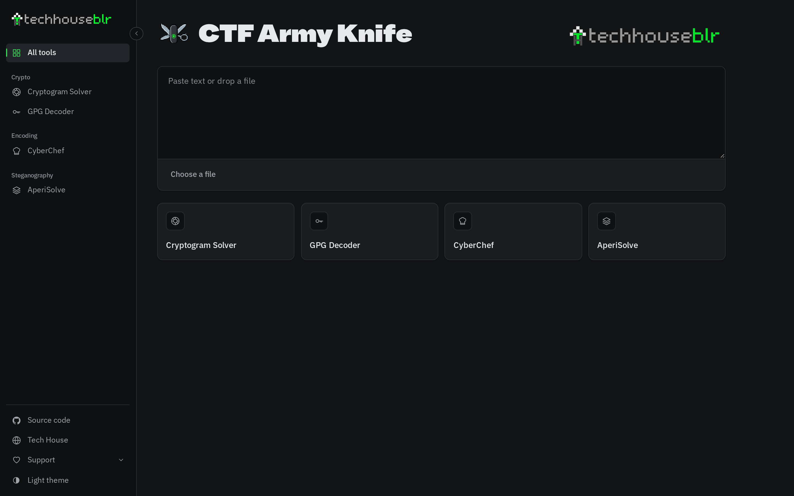
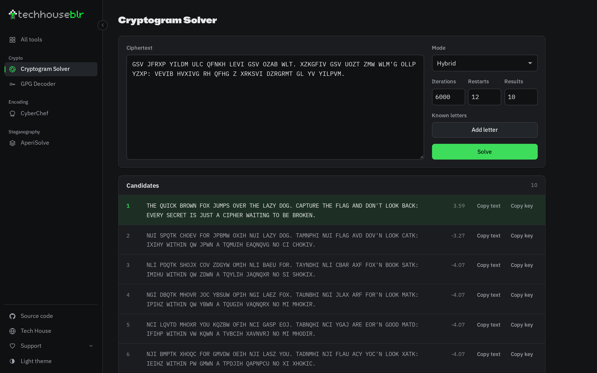
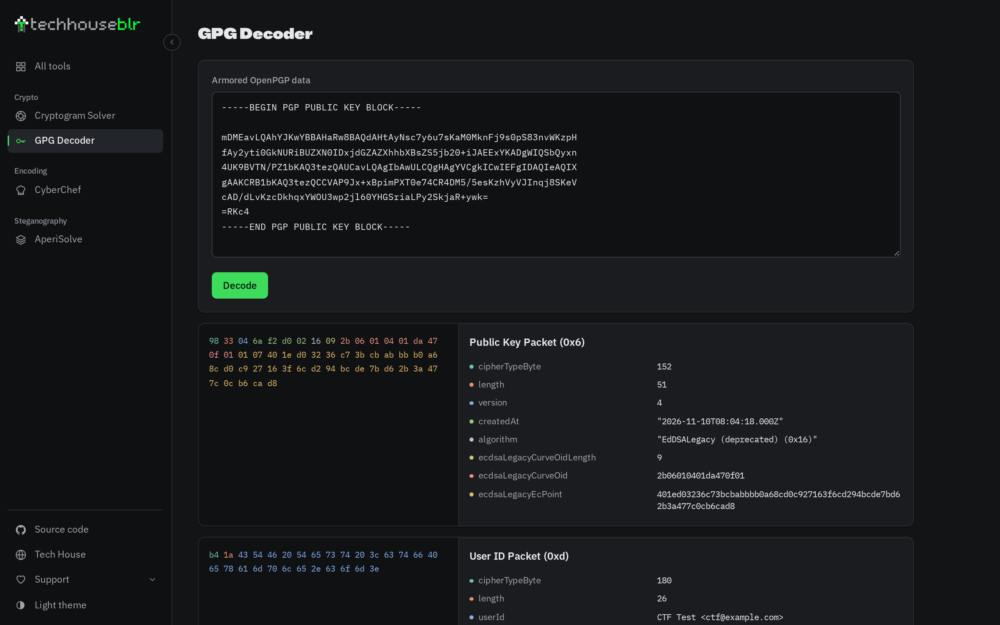
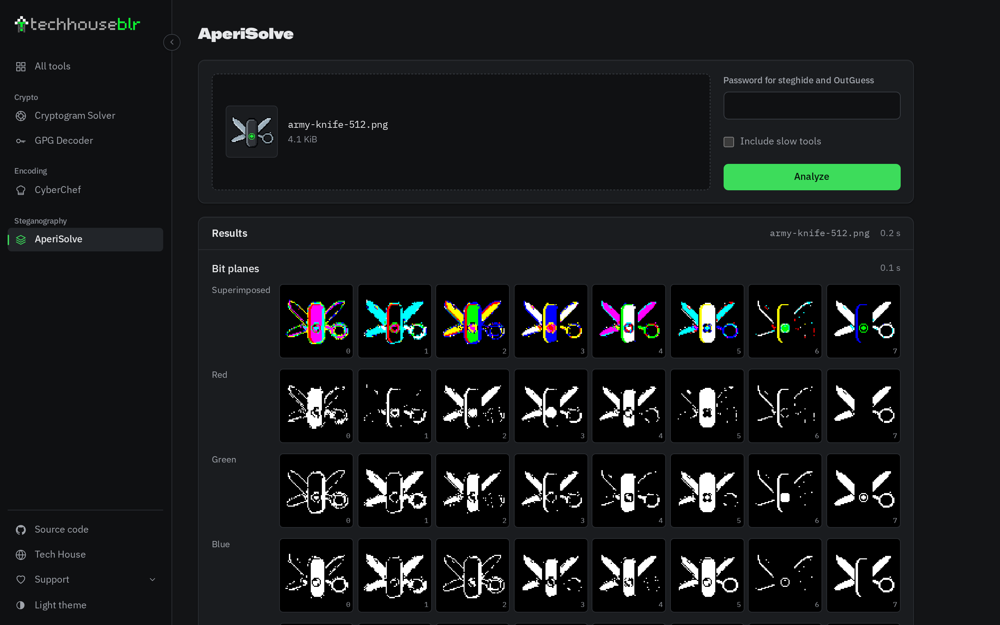
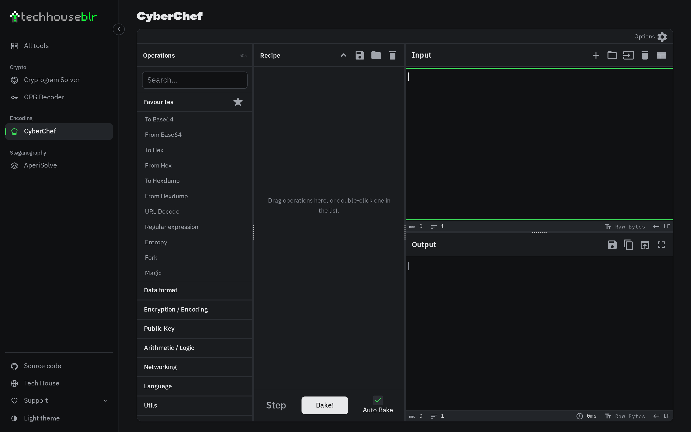
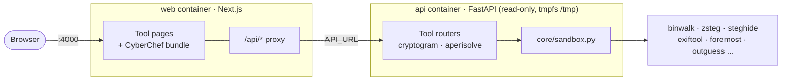

<div align="center">

<a href="https://github.com/tech-house-blr/ctf-army-knife">
  
</a>

# CTF Army Knife

**A Swiss army knife for CTFs.**<br>
Crypto, encoding and steganography tools in one self-hosted web app. Paste or drop a file to get started.

[](https://github.com/tech-house-blr/ctf-army-knife/actions/workflows/ci.yml)
[](https://github.com/tech-house-blr/ctf-army-knife/actions/workflows/cyberchef.yml)
[](LICENSE)


[](https://nextjs.org)
[](https://react.dev)
[](https://www.typescriptlang.org)
[](https://tailwindcss.com)
<br>
[](https://nodejs.org)
[](https://www.python.org)
[](https://fastapi.tiangolo.com)
[](#docker)
[](https://github.com/gchq/CyberChef)

[**Features**](#features) ·
[**Quick start**](#quick-start) ·
[**Architecture**](#architecture) ·
[**Adding a tool**](#adding-a-tool) ·
[**Tests**](#tests) ·
[**Credits**](#branding-credits-and-licences)

<br>

<picture>
  <source media="(prefers-color-scheme: light)" srcset="docs/assets/screenshots/home-light.png">
  
</picture>

</div>

<br>

## Features

| Tool | What it does | Runs in |
| ---- | ------------ | ------- |
| **[Cryptogram Solver](apps/web/app/cryptogram-solver)** | Breaks monoalphabetic substitution ciphers with frequency analysis and simulated annealing, ranks candidates, and lets you pin known letters. | API |
| **[GPG Decoder](apps/web/app/gpg-decoder)** | Inspects OpenPGP packets in armored or binary messages and keys, with a colour-matched hex view next to each parsed field. | Browser |
| **[CyberChef](docs/cyberchef.md)** | The full CyberChef operation catalogue, built from pinned upstream source, themed to match, and served locally. | Browser |
| **[AperiSolve](#aperisolve)** | Image steganography in one click: bit planes, colour remapping, PNG repair, ExifTool, binwalk, foremost, steghide, zsteg, OutGuess and more, streamed as each one finishes. | API |

**Also:**

- **Paste-and-go dashboard.** Paste text or drop a file on the home page and it suggests the right tool.
- **Dark and light themes**, with a collapsible sidebar. Both settings are remembered without flashing on load.
- **Sandboxed tools.** Every external program runs without a shell, with CPU, memory, file-size and time limits, in a throwaway workspace.
- **One command to run it all:** `docker compose up --build`.

<br>

## Screenshots

<table>
  <tr>
    <td width="50%">
      <picture>
        <source media="(prefers-color-scheme: light)" srcset="docs/assets/screenshots/cryptogram-light.png">
        
      </picture>
      <p align="center"><b>Cryptogram Solver</b><br><sub>Ranked candidates with scores, plus copy text or key</sub></p>
    </td>
    <td width="50%">
      <picture>
        <source media="(prefers-color-scheme: light)" srcset="docs/assets/screenshots/gpg-light.png">
        
      </picture>
      <p align="center"><b>GPG Decoder</b><br><sub>Packet-by-packet breakdown with a matching hex view</sub></p>
    </td>
  </tr>
  <tr>
    <td width="50%">
      <picture>
        <source media="(prefers-color-scheme: light)" srcset="docs/assets/screenshots/aperisolve-light.png">
        
      </picture>
      <p align="center"><b>AperiSolve</b><br><sub>Bit planes for every channel, streamed live</sub></p>
    </td>
    <td width="50%">
      <picture>
        <source media="(prefers-color-scheme: light)" srcset="docs/assets/screenshots/cyberchef-light.png">
        
      </picture>
      <p align="center"><b>CyberChef</b><br><sub>The full catalogue, themed and served locally</sub></p>
    </td>
  </tr>
</table>

<br>

## Quick start

### Docker

```bash
docker compose up --build
```

Then open **<http://localhost:4000>**.

> [!NOTE]
> The first build takes a while because it compiles CyberChef. After that it stays cached until `vendor/`, `integration/` or `scripts/` change.

### Local development

You need **Node.js 24** and **Python 3.12 or newer**. Docker isn't needed.

```bash
npm run setup      # once: npm ci, the API virtualenv and its packages, CyberChef
npm run dev:all    # API on :8000 and web app on http://localhost:4000, in one terminal
```

`dev:all` labels each server's output and stops both on <kbd>Ctrl</kbd>+<kbd>C</kbd>. It reuses the existing CyberChef build, so run `npm run cyberchef:build` after changing `integration/cyberchef/`.

> [!TIP]
> AperiSolve's CLI tools (binwalk, zsteg, steghide, ExifTool...) are only installed in the API's Docker image. Run locally, those analyzers report "not installed". The pure-Python ones, such as bit planes and colour remapping, still work.

<details>
<summary><b>Running the servers separately</b></summary>
<br>

| Server | Command |
| ------ | ------- |
| Web app | `npm run dev -w @ctf-army-knife/web` |
| API (from `apps/api`) | `.venv/bin/uvicorn ctf_api.main:app --reload --port 8000` |

The web app proxies `/api/*` to `API_URL` (default `http://127.0.0.1:8000`), so frontend code always calls same-origin paths like `fetch("/api/solve")`.

</details>

<br>

## Architecture



The browser only talks to the web container. The API isn't published to the host, and its tool workspaces live in a capped in-memory `tmpfs`, so an extraction bomb fails instead of filling the disk.

<details>
<summary><b>Repository layout</b></summary>
<br>

```
apps/
  web/                    Next.js frontend (npm workspace)
    app/<tool-slug>/      one route per tool, kebab-case
    app/api/[...path]/    same-origin proxy to the API
    lib/tools/registry.ts the list of tools shown in the sidebar and dashboard
    lib/tools/<tool>/     client-side logic for a tool (e.g. gpg-decoder/)
  api/                    FastAPI backend
    ctf_api/main.py       wires tool routers together
    ctf_api/tools/<tool>/ server-side logic for a tool (e.g. cryptogram/)
    tests/
vendor/cyberchef/         pinned upstream CyberChef source (git subtree)
integration/cyberchef/    our theme, bridge and build patches for CyberChef
scripts/                  CyberChef build tooling; setup, dev:all and test:api helpers
tests/
  web/                    unit tests for client-side tool logic
  cyberchef/              CyberChef integration tests
  browser/                Playwright end-to-end tests
docs/                     longer-form documentation
```

</details>

<br>

## Adding a tool

1. Add an entry to [`apps/web/lib/tools/registry.ts`](apps/web/lib/tools/registry.ts). The sidebar and dashboard pick it up automatically.
2. Create the page at `apps/web/app/<slug>/page.tsx`.
3. Put the tool's logic in `apps/web/lib/tools/<slug>/` if it runs in the browser. If it needs the server, put it in `apps/api/ctf_api/tools/<name>/` with a `router.py`, register the router in `ctf_api/main.py`, and set `needsApi: true` in the registry. Call it from the page as `/api/...`.
4. Add tests under `tests/web/` or `apps/api/tests/`.

> [!IMPORTANT]
> `npm run test:unit` fails if a registry entry has no page, or a page is missing from the registry.

### Tools that run external programs

Anything that runs a CLI tool (steghide, binwalk, zsteg, ...) on user files **must** go through `ctf_api/core/sandbox.py`, never `subprocess` directly:

```python
from ctf_api.core.sandbox import run_tool, save_upload, workspace

@router.post("/api/my-tool")
async def analyze(file: UploadFile):
    with workspace() as cwd:                      # private temp dir, always deleted
        image = cwd / "input"
        await save_upload(file, image)            # 413 above TOOL_MAX_UPLOAD_BYTES
        result = run_tool(["exiftool", image], cwd=cwd, timeout=20)
    return result.to_dict()                       # missing tool / timeout reported, not raised
```

`run_tool` runs without a shell, kills the whole process tree on timeout, caps CPU, memory and file size, truncates output, and hides server environment variables. Register new executables in `ctf_api/core/external_tools.py` and install them in `apps/api/Dockerfile`. `GET /api/capabilities` reports which ones a deployment has.

<br>

## Tests

| Command | Covers |
| ------- | ------ |
| `npm run test:unit` | Client-side tool logic and the tool registry |
| `npm run test:integration` | CyberChef build tooling |
| `npm run lint` | ESLint |
| `npm run test:browser` | Playwright end-to-end tests (needs `npx playwright install`) |
| `npm run test:api` | API, in its virtualenv (tool tests skip if a tool isn't installed) |

CI runs lint, unit, integration and build checks on every push, plus the API tests both on a plain runner and inside the real read-only API image. The slower CyberChef suite (Windows build, upstream tests, browser tests) only runs when its inputs change.

<br>

## AperiSolve

`/aperisolve` takes an upload and runs every applicable analyzer in parallel, streaming each result as it finishes:

> bit planes · colour remapping · PNG repair (PCRT) · file · ExifTool · binwalk · foremost · pngcheck · identify · steghide · zsteg · strings · OutGuess (with "Deep analysis")

Generated images and extracted archives are kept for 30 minutes, within a 256 MiB total budget (oldest deleted first). If the browser disconnects, the API kills that analysis's running tools.

<details>
<summary><b>Limits, configuration and what's not ported yet</b></summary>
<br>

Limits are set with `APERISOLVE_*` environment variables in `ctf_api/tools/aperisolve/`: upload size, tool timeout, image size, result TTL, stored-results budget and concurrent analyses. The web page reads the upload limit from the API, but uploads above 25 MiB also need the proxy's `API_MAX_BODY_BYTES` raised.

**Not ported (yet):** jsteg, jpseek and OpenStego, which aren't packaged for Debian, and upstream's audio spectrogram and PDF analyzers.

</details>

The analyzers are adapted from [AperiSolve](https://github.com/Zeecka/AperiSolve) (MIT); see [`NOTICE`](apps/api/ctf_api/tools/aperisolve/NOTICE).

<br>

## CyberChef integration

CyberChef is built from a pinned upstream source subtree with a community theme, and the Next.js server serves it. See [setup, validation, deployment and updates](docs/cyberchef.md).

<br>

## Branding, credits and licences

The code in this repository is released under the [MIT License](LICENSE), with these exceptions:

| Path | Licence |
| ---- | ------- |
| `vendor/cyberchef/` | Apache-2.0, © Crown Copyright ([LICENSE](vendor/cyberchef/LICENSE)) |
| Code adapted from AperiSolve in `apps/api/ctf_api/tools/aperisolve/` | MIT, © Zeecka ([NOTICE](apps/api/ctf_api/tools/aperisolve/NOTICE)) |
| Tech House BLR brand assets in `apps/web/public/brand/techhouse-*` | CC BY-NC-ND 4.0, © Tech House BLR (see below) |
| Fonts in `apps/web/public/fonts/` | SIL Open Font License 1.1 |

<details>
<summary><b>Tech House BLR brand assets</b></summary>
<br>

The interface carries the Tech House BLR logo: the original brand images from the Tech House website, trimmed and exported at their display sizes in `apps/web/public/brand` (used by `apps/web/components/brand.tsx`), and the mark as the favicon (`apps/web/app/icon.png`). The Tech House brand assets are **CC BY-NC-ND 4.0** and belong to Tech House BLR. They are not covered by this repository's code licence, so don't reuse or modify them outside this project without permission.

</details>

<details>
<summary><b>The army knife icon</b></summary>
<br>

The CTF Army Knife icon is pixel art made with PixelLab (64x64 original in `apps/web/public/brand/army-knife-64.png`). It is only ever shown at whole-number scales (favicon `apps/web/app/icon.png` at 32 px, 2x/3x/8x copies for the home page, Apple touch icon and web manifest) so its pixels stay sharp. The 16 px favicon (`apps/web/app/icon1.png`) is hand-placed from it with `scripts/army-knife-icon-16.py`, since no generated 16 px version held up.

</details>

<details>
<summary><b>Fonts</b></summary>
<br>

Fonts in `apps/web/public/fonts` are under the SIL Open Font License (see the `OFL-*.txt` files beside them): IBM Plex Sans and Mono for the interface, and BBH Hegarty, the Tech House display face, for names and titles.

</details>

**Built on the shoulders of:** [CyberChef](https://github.com/gchq/CyberChef) by GCHQ · [AperiSolve](https://github.com/Zeecka/AperiSolve) by Zeecka

<br>

<div align="center">

Made by **[Tech House BLR](https://www.techhouseblr.com)**

[](https://www.techhouseblr.com)
[](https://github.com/tech-house-blr)
[](https://instagram.com/tech.house.blr)
[](https://x.com/TechHouseBlr)

<sub>Happy hacking. Go capture some flags.</sub>

</div>
